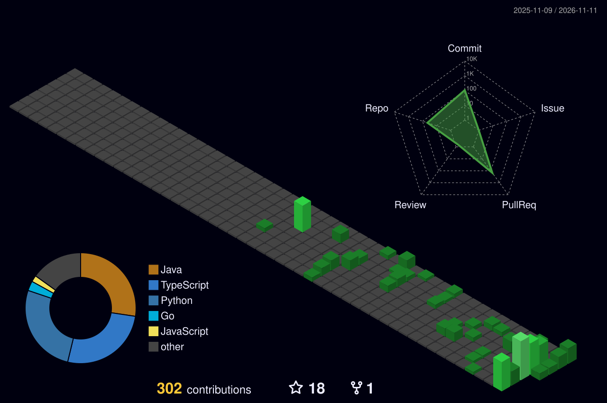

<h1 align="center">Hey, welcome to my corner.</h1>

  <picture>
    <source media="(prefers-color-scheme: dark)" srcset="./dist/github-contribution-grid-snake-dark.svg">
    <source media="(prefers-color-scheme: light)" srcset="./dist/github-contribution-grid-snake.svg">
    
  </picture>

  

  

  
  
  
  
  

  
  
  
  
  
  

  
  

### About Me

- **Background:** Software Engineering undergraduate at **Henan University of Science and Technology**, graduating in **2028**.
- **Building:** Java backends and AI agent applications with **Spring Boot**, **Spring AI**, and **Spring AI Alibaba**.
- **Exploring:** **Agent Runtime**, **MCP**, context and memory, retrieval, and evaluation.

  
  

---

## Open Source

I like practical work on agents, MCP, and the libraries around them: reproduce the issue, fix the cause, and keep the change easy to review.

**Featured**

- [kividbio/kividb#480](https://github.com/kividbio/kividb/pull/480) — Re-ran the LlamaIndex compatibility harness on current master; 54 of 54 checks still pass.
- [doobidoo/mcp-memory-service#1865](https://github.com/doobidoo/mcp-memory-service/pull/1865) — Marks beliefs and summaries stale when their source memory is deleted.
- [kestra-io/plugin-ai#439](https://github.com/kestra-io/plugin-ai/pull/439) — Restricts the KestraFlow agent tool to an allowlist of namespace and flow pairs.
- [agentscope-ai/agentscope-java#3156](https://github.com/agentscope-ai/agentscope-java/pull/3156) — Switches Spring Boot to modular core and AG-UI dependencies to avoid duplicate classes.
- [apache/seatunnel#12222](https://github.com/apache/seatunnel/pull/12222) — Rejects blank Lance sink paths and invalid namespace types before write.

[All contributions](https://github.com/pulls?q=is%3Apr+author%3AZYZ666-RGB+-user%3AZYZ666-RGB) · [Merged](https://github.com/pulls?q=is%3Apr+author%3AZYZ666-RGB+-user%3AZYZ666-RGB+is%3Amerged) · [Open](https://github.com/pulls?q=is%3Apr+author%3AZYZ666-RGB+-user%3AZYZ666-RGB+is%3Aopen)

---

### Profile Score

<a href="https://ghfind.com/u/ZYZ666-RGB?ref=badge">
  <picture>
    <source media="(prefers-color-scheme: dark)" srcset="https://ghfind.com/api/card/mini/ZYZ666-RGB?theme=dark&amp;lang=en&amp;v=20261017">
    
  </picture>
</a>
